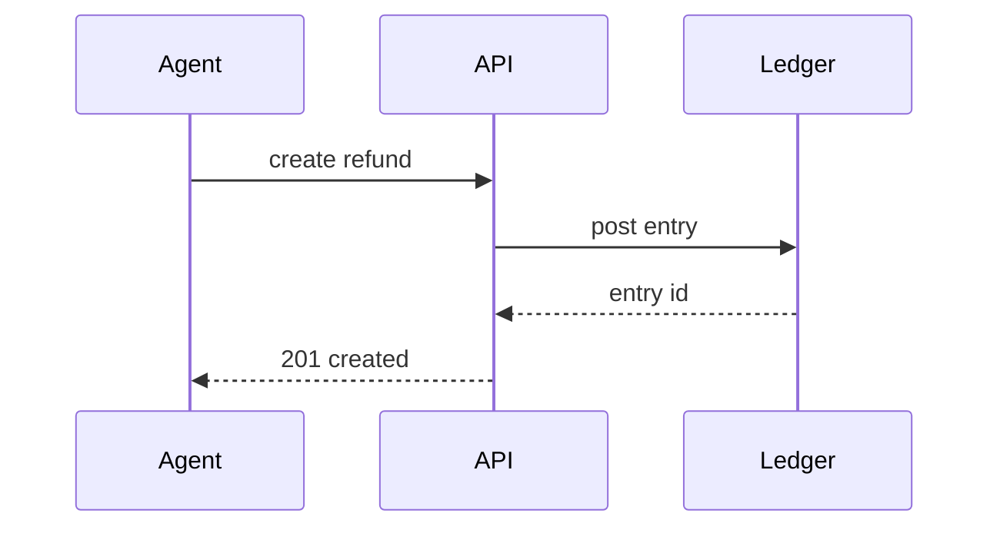

{{meta}}

{{toc}}

This page is a worked sample of every display container the skill can generate. It is written for a fictional space named DEMO; the IDs and names are illustrative. Copy the containers you need, delete the rest, and keep the frontmatter contract.

## 1. Purpose and scope

The purpose is to show, in one page, how each Confluence Cloud format looks in storage output and when it is the right choice. The scope is presentation only: no real product decision is recorded here.

Use this page together with guide 03 for the decision rules and guide 04 for the full syntax catalogue. When a format is not in the catalogue, use a fenced `storage` block and verify the fragment with `--check`.

## 2. Text and emphasis

Prose carries the argument, so it stays the default container. **Bold** marks the one fact a skimming reader must not miss, `inline code` marks identifiers, and ~~strikethrough~~ marks removed scope with the reason in the sentence around it.

Keep one idea per sentence and never exceed 180 words per paragraph. Where a reader scans three or more parallel facts, replace the sentence list with a table, as the next sections demonstrate.

## 3. Status, dates and people

Status and dates need machine-readable containers, not coloured letters. The controlled status vocabulary renders as a lozenge: {{status:green|Approved}}, {{status:yellow|In Review}} and {{status:grey|Draft}}.

| Milestone | Date | Owner | State |
|---|---|---|---|
| Draft circulated | {{date:2026-11-05}} | Nguyen Minh An | {{status:green|Done}} |
| Guild review | {{date:2026-11-12}} | Tran Minh Quan | {{status:green|Done}} |
| Sign-off | {{date:2026-11-19}} | Acme Documentation Guild | {{status:green|Approved}} |

The tracked issue is {{jira:SHOW-100}} and the outcome signal is {{emoji:thumbs-up}}. Dates written with `{{date:...}}` stay sortable and render in each reader's locale.

## 4. Highlighted containers

Callouts carry exceptions, risks and decisions; the page budget is five or fewer. Each container below has a title so a scanning reader knows what the colour means before reading it.

:::warning Sample data only
This page references fictional space DEMO and issue SHOW-100. Never publish sample IDs to a real space.
:::

:::tip Title your callouts
Every `:::info`, `:::tip` and `:::warning` accepts a title: `:::tip Title your callouts`. An untitled yellow box is decoration, a titled one is a signposted fact.
:::

:::info Page relationships
{{children}} lists subpages of the live page and {{include:DEMO:Refund runbook}} embeds a named page; both keep the single source of truth on the owning page.
:::

:::quote
A reader should know what this page is, who owns it, whether it is approved and what changed last — within thirty seconds.
:::

## 5. Depth containers

Long evidence does not belong in the reading line; it belongs behind an expand or beside its summary in columns. The expand below collapses a payload sample; the columns sit the decision next to its counter-evidence.

:::columns
**Decision:** refund asynchronously through the ledger.

Risk is lower because the ledger guarantees idempotency.
||
**Counter-evidence:** synchronous refunds feel faster to support agents, but the p99 latency would double and retry storms return.
:::

:::expand Full payload example
```json title="refund-request.json"
{
  "refundId": "RF-2026-000123",
  "paymentRef": "PM-98765",
  "amount": {"value": 2500000, "currency": "VND"},
  "reason": "DUPLICATE_CHARGE"
}
```
:::

## 6. Tables

Tables are the default for parallel facts, and the first column is always a stable ID. Requirement rows carry a source, and column counts stay at six or fewer.

| ID | Requirement | Priority | Source |
|---|---|---|---|
| FR-101 | Refund up to the captured amount | Must | {{jira:SHOW-100}} |
| FR-102 | Reject duplicate refund requests | Must | {{jira:SHOW-100}} |
| FR-103 | Export refunds to the ledger nightly | Should | SHOW-100 |
| AC-101 | Given a captured payment, when a larger refund is requested, then the API returns 422 | Must | SHOW-100 |

## 7. Lists and checklists

Sequences stay as numbered lists; owned, dated work becomes a task list so completion survives every export.

1. Open the refund request.
2. Validate against the ledger.
3. Record the outcome.

- [x] Publish the showcase page
- [x] Lint at profile generic with zero findings
- [ ] Link the showcase from the space home page

## 8. Code, math and diagrams

Evidence containers keep the prose clean. Code fences carry a title so the reader knows what file is shown; `math` renders as a formula; `mermaid` renders as a diagram on tenants that have the plugin, and guide 06 gives the table fallback.

```sql title="refund-audit.sql"
SELECT refund_id, amount_minor, created_at
FROM refunds
WHERE status = 'COMPLETED' AND created_at >= CURRENT_DATE - 7;
```

The idempotency window follows:

```math
P(\text{duplicate}) = 1 - e^{-\lambda T}
```



## 9. Media and links

External media embeds instead of being described in words, and images always carry alt text: . The video walkthrough is embedded below and linked descriptively at [the demo recording on YouTube](https://www.youtube.com/watch?v=example).

{{embed:https://www.youtube.com/watch?v=example}}

Anchors make sections citable from Jira and other pages: {{anchor:format-decision}}. Link text names the destination, never the word "here", and the storage escape hatch below shows raw XHTML for anything the catalogue does not cover.

```storage
<hr />
```

## 10. Choosing the right format

The decision rule is a ladder, not a menu: tables for parallel facts, prose for argument, callouts for exceptions, expands for evidence, columns for side-by-side, task lists for owned work, media for recordings.

| Content | Wrong container | Right container | Syntax |
|---|---|---|---|
| Three or more parallel facts | Bullet wall | Table with ID column | `| ID | ... |` |
| A risk or a deadline exception | Bold paragraph | Titled warning or info | `:::warning Title` |
| Long payload or SQL output | Inline code in prose | Expand around a code fence | `:::expand Title` |
| Decision and counter-evidence | Two far-apart sections | Two or three columns | `:::columns ... || ... :::` |
| Action items with owners | Unchecked bullet list | Task list | `- [ ] item` |
| A formula | ASCII art | Math code macro | ```` ```math ```` |
| A recording or dashboard link | Bare URL paragraph | Embed macro | `{{embed:URL}}` |
| Anything exotic | Ignored literal text | Raw storage fence | ```` ```storage ```` |

## 11. Change log

| Version | Date | Author | Change | Jira |
|---|---|---|---|---|
| 1.0 | 2026-11-19 | Acme Documentation Guild | Initial showcase covering all supported display containers | SHOW-100 |
