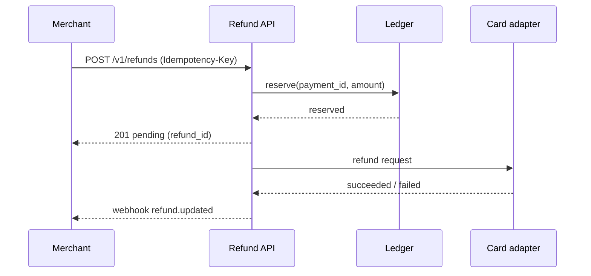

{{meta}}

{{toc}}

## 1. Mục đích và phạm vi

Tài liệu đặc tả hành vi hoàn tiền cho thanh toán thẻ và ví điện tử trên nền tảng Acme Pay. Đây là hợp đồng triển khai cho team Payments, nguồn tham chiếu cho thiết kế kiểm thử của QA và căn cứ nghiệm thu cho đợt phát hành tháng 12 năm 2026.

:::info
**Cần chốt trước 2026-11-24.** Phương án hoàn tiền một phần cho thẻ đã hết hạn cần được Product, Risk và Payments thống nhất. Người chịu trách nhiệm: Trần Minh Quân. Theo dõi tại {{jira:PAY-1420}}.
:::

### 1.1 Trong phạm vi

| Năng lực | Bao gồm | Ghi chú |
|---|---|---|
| Hoàn tiền một phần | Có | Số tiền hoàn nhỏ hơn hoặc bằng số tiền đã thu |
| Hoàn tiền toàn bộ | Có | Số tiền hoàn bằng đúng số tiền còn lại |
| Thẻ và ví điện tử | Có | Cùng một API, khác adapter theo phương thức |
| Chống trùng lặp | Có | Bắt buộc header `Idempotency-Key` cho mọi yêu cầu tạo hoàn tiền |
| Phê duyệt thủ công | Có | Áp dụng cho giao dịch từ 50.000.000 VND |
| Hoàn tiền xuyên biên giới | Không | Thuộc phạm vi của team Cross-border, xem 1.2 |

### 1.2 Ngoài phạm vi

| Năng lực bị loại trừ | Lý do | Đơn vị xử lý |
|---|---|---|
| Chargeback và tranh chấp | Quy trình riêng của Risk Operations | Team Risk Ops |
| Hoàn tiền cho thẻ đã đóng | Phụ thuộc chính sách của tổ chức phát hành | Team Card Network |
| Hoàn tiền xuyên biên giới | Chưa nằm trong giấy phép của đợt phát hành này | Team Cross-border |
| Đối soát tài chính cuối ngày | Thuộc ledger service, không thuộc refund service | Team Ledger |

## 2. Các bên liên quan

| Vai trò | Họ tên | Trách nhiệm | RACI |
|---|---|---|---|
| Product owner | Trần Minh Quân | Phạm vi, ưu tiên và nghiệm thu | A |
| Engineering lead | Nguyễn Minh An | Thiết kế và triển khai | R |
| QA lead | Lê Thu Hà | Chiến lược kiểm thử và bằng chứng nghiệm thu | R |
| Security engineer | Phạm Đức Long | Đánh giá mối đe dọa và xử lý dữ liệu thẻ | C |
| SRE / Vận hành | Vũ Hoàng Nam | Runbook, giám sát và rollback | C |
| Compliance | Đỗ Thị Mai | Đánh giá tuân thủ PCI DSS và lưu trữ chứng từ | C |
| Team Ledger | Ngô Thanh Tùng | Sở hữu bút toán và đối soát | I |

## 3. Giả định và ràng buộc

| ID | Loại | Nội dung | Ảnh hưởng nếu sai |
|---|---|---|---|
| ASM-001 | Giả định | Mọi giao dịch gốc đều có `payment_id` bất biến và tra cứu được trong 180 ngày | Không thể xác thực hoàn tiền; phải bổ sung kho tra cứu |
| ASM-002 | Giả định | Ledger service xử lý bút toán theo mô hình append-only | Phải thiết kế lại cơ chế đối soát |
| CON-001 | Ràng buộc | Dữ liệu thẻ không được rời khỏi vùng PCI; refund service chỉ lưu token | Không được phát hành nếu vi phạm |
| CON-002 | Ràng buộc | Thời gian phản hồi API đồng bộ không vượt quá 2 giây | Phải chuyển sang mô hình bất đồng bộ |

## 4. Yêu cầu chức năng

Bảng dưới đây là chỉ mục yêu cầu. Mỗi yêu cầu có một kết quả quan sát được, một mức ưu tiên và một issue nguồn. Hành vi chi tiết và trường hợp biên được mô tả tại mục 4.1 và 4.2.

| ID | Yêu cầu | Ưu tiên | Jira | Trạng thái |
|---|---|---|---|---|
| FR-001 | Hệ thống tạo hoàn tiền một phần hoặc toàn bộ cho một giao dịch đã thu tiền | Must | {{jira:PAY-1420}} | {{status:green\|Approved}} |
| FR-002 | Hệ thống trả lại kết quả cũ khi cùng `Idempotency-Key` được gửi lặp | Must | {{jira:PAY-1421}} | {{status:green\|Approved}} |
| FR-003 | Hệ thống cung cấp trạng thái hoàn tiền theo thời gian thực qua API và sự kiện | Must | {{jira:PAY-1422}} | {{status:green\|Approved}} |
| FR-004 | Hệ thống yêu cầu phê duyệt kép cho hoàn tiền từ 50.000.000 VND | Must | {{jira:PAY-1455}} | {{status:green\|Approved}} |
| FR-005 | Hệ thống ghi audit log bất biến cho mọi thao tác tạo, duyệt và hủy hoàn tiền | Must | {{jira:PAY-1423}} | {{status:green\|Approved}} |

### 4.1 FR-001 — Tạo hoàn tiền

Hệ thống **phải** tạo một bản ghi hoàn tiền với trạng thái `pending`, giữ chỗ số tiền trên giao dịch gốc và phát sự kiện `refund.created` trong vòng 2 giây. Quy tắc áp dụng cho thanh toán thẻ và ví điện tử đã ở trạng thái `captured`.

| Thuộc tính | Giá trị |
|---|---|
| Điều kiện kích hoạt | Merchant gọi `POST /v1/refunds` hoặc nhân viên vận hành tạo yêu cầu trên Operations Console |
| Đầu vào | `payment_id` (UUID), `amount` (decimal 18,2), `reason_code` (enum), `Idempotency-Key` (UUID) |
| Đầu ra | `refund_id`, `status=pending`, `reserved_amount`, `created_at` |
| Điều kiện tiên quyết | Giao dịch gốc `captured`, còn số tiền hoàn khả dụng, trong hạn 180 ngày |
| Điều kiện sau | Số tiền được giữ chỗ trên ledger và không thể dùng cho yêu cầu khác |
| Hành vi khi lỗi | Trả mã lỗi ổn định trong envelope chung; không tạo bản ghi khi xác thực thất bại |

#### Trường hợp biên

| Trường hợp | Hành vi mong đợi | Mã lỗi |
|---|---|---|
| Hoàn tiền đúng bằng số còn lại | Chấp nhận; giao dịch chuyển sang `fully_refunded` sau khi ledger xác nhận | Không có |
| Số tiền hoàn vượt số còn lại | Từ chối, không giữ chỗ | `REFUND_AMOUNT_EXCEEDED` |
| Giao dịch đã hoàn tiền toàn bộ | Từ chối | `PAYMENT_NOT_REFUNDABLE` |
| Giao dịch quá hạn 180 ngày | Từ chối và gợi ý kênh xử lý thủ công | `REFUND_WINDOW_EXPIRED` |
| Ledger timeout | Giữ trạng thái `pending`, retry nền, trả `202` kèm `refund_id` | Không có |

### 4.2 FR-002 — Chống trùng lặp

Hệ thống **phải** lưu khóa idempotency trong 24 giờ và trả lại nguyên vẹn kết quả của lần gọi đầu tiên khi cùng khóa được gửi lại với cùng payload. Nếu cùng khóa nhưng payload khác, hệ thống trả `409` và không tạo bản ghi mới.

| Thuộc tính | Giá trị |
|---|---|
| Điều kiện kích hoạt | Mọi yêu cầu `POST /v1/refunds` |
| Đầu vào | `Idempotency-Key`, hash của payload chuẩn hóa |
| Đầu ra | Kết quả gốc kèm header `Idempotent-Replay: true` |
| Điều kiện tiên quyết | Khóa chưa hết hạn hoặc chưa bị thu hồi |
| Điều kiện sau | Không phát sinh bút toán thứ hai |
| Hành vi khi lỗi | `IDEMPOTENCY_KEY_REUSED` khi payload khác; `IDEMPOTENCY_KEY_EXPIRED` khi quá 24 giờ |

## 5. Yêu cầu phi chức năng

| ID | Nhóm | Mục tiêu | Cách đo | Jira |
|---|---|---|---|---|
| NFR-001 | Hiệu năng | p95 dưới 400 ms tại 300 request/giây | Load test staging, 30 phút, dữ liệu đại diện | {{jira:PAY-1424}} |
| NFR-002 | Sẵn sàng | 99,95% availability theo tháng | Dashboard SLO, cửa sổ 28 ngày | {{jira:PAY-1424}} |
| NFR-003 | Bảo mật | Không lưu số thẻ đầy đủ; chỉ lưu token và 4 số cuối | Rà soát PCI DSS và quét log | {{jira:PAY-1425}} |
| NFR-004 | Khả năng quan sát | Mọi lỗi có `trace_id`, metric và log cấu trúc | Kiểm tra dashboard và alert test | {{jira:PAY-1426}} |
| NFR-005 | Khả năng tiếp cận | Operations Console đạt WCAG 2.2 AA | Axe audit và kiểm tra bàn phím thủ công | {{jira:PAY-1427}} |

## 6. Quy tắc nghiệp vụ

| ID | Quy tắc | Nơi thực thi | Mã lỗi | Jira |
|---|---|---|---|---|
| {{anchor:br-001}} BR-001 | Tổng số tiền hoàn không được vượt số tiền đã thu của giao dịch | Refund service và ràng buộc ledger | `REFUND_AMOUNT_EXCEEDED` | {{jira:PAY-1420}} |
| {{anchor:br-002}} BR-002 | Chỉ giao dịch `captured` trong 180 ngày mới được hoàn tiền | Refund service | `PAYMENT_NOT_REFUNDABLE` | {{jira:PAY-1420}} |
| BR-003 | Một `Idempotency-Key` chỉ ánh xạ tới một payload trong 24 giờ | Refund service và Redis | `IDEMPOTENCY_KEY_REUSED` | {{jira:PAY-1421}} |
| BR-004 | Hoàn tiền từ 50.000.000 VND cần hai người duyệt khác nhau | Workflow engine | `APPROVAL_REQUIRED` | {{jira:PAY-1455}} |
| BR-005 | Không được hủy hoàn tiền đã ở trạng thái `succeeded` | Refund service | `REFUND_NOT_CANCELLABLE` | {{jira:PAY-1423}} |

## 7. Mô hình dữ liệu

Mô hình dưới đây là chuẩn. Tên trường khớp với hợp đồng API tại mục 8 và không được đổi nếu chưa có phiên bản API mới.

| Entity | Mục đích | Thời gian lưu trữ | Chủ sở hữu |
|---|---|---|---|
| Refund | Một yêu cầu hoàn tiền và vòng đời của nó | 7 năm | Team Payments |
| RefundLine | Phân bổ số tiền hoàn theo từng khoản của giao dịch gốc | 7 năm | Team Payments |
| RefundAudit | Vết kiểm tra bất biến cho mọi thao tác | 10 năm | Team Compliance |

### 7.1 Refund

| Trường | Kiểu | Bắt buộc | Ràng buộc | Mô tả |
|---|---|---|---|---|
| `id` | string (UUID) | Có | Bất biến | Khóa chính |
| `payment_id` | string (UUID) | Có | Trỏ tới giao dịch gốc | Giao dịch được hoàn tiền |
| `amount` | decimal(18,2) | Có | Lớn hơn 0 | Số tiền hoàn theo đơn vị tiền của giao dịch |
| `currency` | string (ISO 4217) | Có | Khớp giao dịch gốc | Đơn vị tiền tệ |
| `status` | enum | Có | `pending`, `succeeded`, `failed`, `cancelled` | Trạng thái vòng đời |
| `reason_code` | enum | Có | `customer_request`, `duplicate`, `fraud`, `service_failure` | Lý do hoàn tiền |
| `approved_by` | list[string] | Không | Hai account ID khác nhau khi áp dụng BR-004 | Người phê duyệt |
| `idempotency_key` | string (UUID) | Có | Duy nhất trong 24 giờ | Khóa chống trùng lặp |
| `created_at` | timestamp | Có | ISO 8601, UTC | Thời điểm tạo |
| `updated_at` | timestamp | Có | ISO 8601, UTC | Thời điểm cập nhật gần nhất |

## 8. Tích hợp và hợp đồng API

| Bên gọi | Bên cung cấp | Giao thức | Mục đích | Chủ sở hữu |
|---|---|---|---|---|
| Merchant platform | Refund API | REST / HTTPS | Tạo và tra cứu hoàn tiền | Team Payments |
| Refund API | Ledger service | gRPC nội bộ | Giữ chỗ và ghi bút toán | Team Ledger |
| Refund API | Card adapter | REST / HTTPS | Gửi yêu cầu hoàn tiền tới tổ chức phát hành | Team Card Network |
| Refund API | Notification service | Kafka event | Thông báo cho merchant và khách hàng | Team Engagement |

### 8.1 Endpoint

| Method | Path | Mục đích | Xác thực | Idempotency |
|---|---|---|---|---|
| POST | `/v1/refunds` | Tạo hoàn tiền | OAuth 2.0 client credentials | Bắt buộc `Idempotency-Key` |
| GET | `/v1/refunds/{refund_id}` | Đọc trạng thái hoàn tiền | OAuth 2.0 client credentials | An toàn, lặp lại được |
| GET | `/v1/payments/{payment_id}/refunds` | Liệt kê hoàn tiền của giao dịch | OAuth 2.0 client credentials | An toàn, lặp lại được |
| POST | `/v1/refunds/{refund_id}/approve` | Phê duyệt hoàn tiền | OAuth 2.0 + role `refund-approver` | Theo `refund_id` và người duyệt |
| POST | `/v1/refunds/{refund_id}/cancel` | Hủy hoàn tiền chưa thành công | OAuth 2.0 client credentials | Theo trạng thái hiện tại |

### 8.2 Xử lý lỗi

| Mã | HTTP | Ý nghĩa | Retry | Thông báo cho người dùng |
|---|---|---|---|---|
| `VALIDATION_FAILED` | 400 | Thiếu trường hoặc sai định dạng | Không | Kiểm tra trường được đánh dấu trong `details[]` |
| `PAYMENT_NOT_REFUNDABLE` | 422 | Giao dịch không đủ điều kiện hoàn tiền | Không | Giao dịch không thể hoàn tiền; liên hệ bộ phận hỗ trợ |
| `REFUND_AMOUNT_EXCEEDED` | 422 | Số tiền vượt phần còn lại | Không | Số tiền hoàn vượt quá số tiền có thể hoàn |
| `IDEMPOTENCY_KEY_REUSED` | 409 | Khóa đã dùng với payload khác | Không | Yêu cầu trùng khóa nhưng nội dung khác |
| `APPROVAL_REQUIRED` | 409 | Cần phê duyệt kép | Không | Yêu cầu đã được gửi tới người duyệt |
| `DEPENDENCY_UNAVAILABLE` | 503 | Ledger hoặc card adapter không phản hồi | Có, backoff lũy thừa | Hệ thống đang xử lý; vui lòng thử lại sau |

```json title="201 Created"
{
  "id": "9f1c2b7e-4a6d-4f0e-9a21-2f6f7d8c1b30",
  "payment_id": "0b6f3a9d-7c21-4e88-9f4a-5d2c1e8b7a66",
  "amount": 250000.00,
  "currency": "VND",
  "status": "pending",
  "reason_code": "customer_request",
  "created_at": "2026-11-17T08:30:00Z"
}
```

:::note
Schema chuẩn được công bố trong OpenAPI tại [refund-api.yaml](https://api.acmepay.example.com/openapi/refund-api.yaml). Mục này giải thích hành vi và mã lỗi, không sao chép toàn bộ schema.
:::

## 9. Luồng người dùng và ghi chú UX

1. Merchant gửi yêu cầu hoàn tiền kèm `Idempotency-Key` và nhận `refund_id` cùng trạng thái `pending`.
2. Refund service xác thực giao dịch, giữ chỗ số tiền trên ledger và phát sự kiện `refund.created`.
3. Nếu số tiền từ 50.000.000 VND, workflow gửi yêu cầu tới hai người duyệt có role `refund-approver`.
4. Sau khi được duyệt, card adapter gửi yêu cầu tới tổ chức phát hành; trạng thái chuyển `succeeded` hoặc `failed`.
5. Notification service gửi email cho khách hàng và webhook cho merchant.
6. Operations Console hiển thị trạng thái, người duyệt và `trace_id` để hỗ trợ điều tra.



:::note
Sơ đồ dùng macro Mermaid. Nếu space chưa cài ứng dụng Mermaid Diagrams, thay bằng ảnh PNG đã xuất và giữ nguyên phần mô tả bằng bảng.
:::

| Trạng thái | Trải nghiệm mong đợi | Tham chiếu copy |
|---|---|---|
| Đang tải | Hiển thị skeleton cho bảng hoàn tiền và trạng thái từng dòng | UX-REF-01 |
| Rỗng | Hiển thị "Chưa có hoàn tiền nào" và nút tạo yêu cầu nếu có quyền | UX-REF-02 |
| Không có quyền | Ẩn nút tạo và hiển thị thông báo liên hệ quản trị viên | UX-REF-03 |
| Lỗi dependency | Giữ dữ liệu đã tải, hiển thị banner retry và `trace_id` | UX-REF-04 |

## 10. Tiêu chí chấp nhận

| AC ID | Yêu cầu | Kịch bản | Given | When | Then |
|---|---|---|---|---|---|
| AC-001 | FR-001 | Hoàn tiền một phần thành công | Giao dịch đã thu 500.000 VND, còn 500.000 VND khả dụng | Merchant gửi hoàn tiền 200.000 VND | Trả `201`, trạng thái `pending`, ledger giữ chỗ 200.000 VND |
| AC-002 | FR-001 | Hoàn tiền toàn bộ phần còn lại | Giao dịch còn 300.000 VND khả dụng | Merchant gửi hoàn tiền 300.000 VND | Trả `201`; sau khi ledger xác nhận, giao dịch là `fully_refunded` |
| AC-003 | FR-001 | Vượt số tiền khả dụng | Giao dịch còn 100.000 VND khả dụng | Merchant gửi hoàn tiền 150.000 VND | Trả `422` với `REFUND_AMOUNT_EXCEEDED`; không tạo bản ghi |
| AC-004 | FR-002 | Gửi lặp cùng khóa | Yêu cầu đầu tiên đã tạo `refund_id` | Gửi lại cùng payload và cùng `Idempotency-Key` | Trả kết quả cũ, header `Idempotent-Replay: true`, không có bút toán mới |
| AC-005 | FR-003 | Trạng thái cập nhật qua webhook | Yêu cầu đang `pending` | Card adapter trả `succeeded` | Webhook `refund.updated` được phát trong 5 giây |
| AC-006 | FR-004 | Hoàn tiền cần phê duyệt kép | Số tiền hoàn là 60.000.000 VND | Một người duyệt xác nhận | Trạng thái vẫn `pending_approval`; cần người thứ hai khác account ID |
| AC-007 | FR-005 | Audit log đầy đủ | Yêu cầu được tạo và duyệt | Truy vấn `refund_audit` theo `refund_id` | Có bản ghi cho `created`, `approved`, `succeeded`, kèm actor và `trace_id` |
| AC-008 | NFR-001 | Hiệu năng đạt ngưỡng | Môi trường staging với dữ liệu đại diện | Chạy 300 request/giây trong 30 phút | p95 dưới 400 ms, tỷ lệ lỗi dưới 0,1% |

## 11. Rủi ro và câu hỏi mở

### 11.1 Rủi ro

| ID | Rủi ro | Khả năng | Ảnh hưởng | Giảm thiểu | Chủ sở hữu | Trạng thái |
|---|---|---|---|---|---|---|
| RSK-001 | Retry từ merchant tạo hoàn tiền trùng | Trung bình | Cao | Khóa idempotency, unique constraint trên `(payment_id, idempotency_key)` và đối soát cuối ngày | Nguyễn Minh An | {{status:green\|Mitigated}} |
| RSK-002 | Lệch số liệu giữa refund service và ledger | Thấp | Cao | Job đối soát mỗi 15 phút; cảnh báo khi chênh lệch khác 0 | Ngô Thanh Tùng | {{status:yellow\|Monitoring}} |
| RSK-003 | Card adapter timeout kéo dài | Trung bình | Trung bình | Circuit breaker, retry có backoff và trạng thái `pending` có thể tra cứu | Vũ Hoàng Nam | {{status:yellow\|Monitoring}} |
| RSK-004 | Người duyệt dùng chung tài khoản | Thấp | Cao | Kiểm tra `account_id` khác nhau và ghi audit | Phạm Đức Long | {{status:green\|Mitigated}} |

### 11.2 Câu hỏi mở

| ID | Câu hỏi | Chủ sở hữu | Cần trả lời trước | Trạng thái |
|---|---|---|---|---|
| OQ-001 | Hoàn tiền cho thẻ đã hết hạn nên chuyển sang ví hay yêu cầu hỗ trợ thủ công? | Trần Minh Quân | 2026-11-24 | {{status:red\|Open}} |
| OQ-002 | Tỷ giá nào được dùng khi hoàn tiền đa tiền tệ? | Ngô Thanh Tùng | 2026-12-01 | {{status:yellow\|In Review}} |
| OQ-003 | Có cần thông báo cho merchant trước khi hủy hoàn tiền không? | Lê Thu Hà | 2026-11-20 | {{status:green\|Resolved}} |

## 12. Lịch sử thay đổi

| Phiên bản | Ngày | Người cập nhật | Thay đổi | Jira |
|---|---|---|---|---|
| 1.0 | 2026-11-17 | Lê Thu Hà | Phê duyệt sau rà soát bảo mật và tải | {{jira:PAY-1420}} |
| 0.9 | 2026-11-10 | Trần Minh Quân | Bổ sung quy tắc phê duyệt kép BR-004 | {{jira:PAY-1455}} |
| 0.1 | 2026-10-28 | Nguyễn Minh An | Bản nháp đầu tiên | {{jira:PAY-1420}} |

:::expand Chi tiết tính toán phân bổ hoàn tiền
Khi giao dịch có nhiều khoản, hệ thống phân bổ số tiền hoàn theo thứ tự: phí dịch vụ hoàn trước, sau đó đến tiền hàng, cuối cùng là thuế. Quy tắc này bảo đảm merchant không bị hoàn vượt quá số tiền thực nhận.

| Thành phần | Thứ tự phân bổ | Ghi chú |
|---|---|---|
| Phí dịch vụ | 1 | Hoàn tối đa bằng phí đã thu |
| Tiền hàng | 2 | Phân bổ theo từng `RefundLine` |
| Thuế | 3 | Hoàn theo tỷ lệ của phần tiền hàng được hoàn |
:::

## Phụ lục A. Thuật ngữ

| Thuật ngữ | Định nghĩa | Nguồn |
|---|---|---|
| Capture | Thời điểm số tiền được thực sự thu từ phương thức thanh toán | Payment glossary |
| Idempotency key | Khóa do bên gọi tạo để bảo đảm một yêu cầu chỉ có hiệu lực một lần | RFC 7231 |
| Refund line | Một dòng phân bổ số tiền hoàn cho một khoản của giao dịch gốc | Tài liệu này |
| p95 | 95% request có thời gian phản hồi nhỏ hơn hoặc bằng giá trị này | SRE glossary |

## Phụ lục B. Tài liệu tham khảo

| Nguồn | Liên kết | Vì sao quan trọng |
|---|---|---|
| Epic | {{jira:PAY-1420}} | Theo dõi phạm vi và tiến độ |
| Hợp đồng API | [OpenAPI specification](https://api.acmepay.example.com/openapi/refund-api.yaml) | Schema request/response chuẩn |
| Thiết kế | [Figma flow](https://figma.example.com/file/refund-console) | Hành vi và trạng thái màn hình |
| Runbook | [Refund operations runbook](https://confluence.example.com/display/PAY/Refund+Runbook) | Quy trình on-call và rollback |
