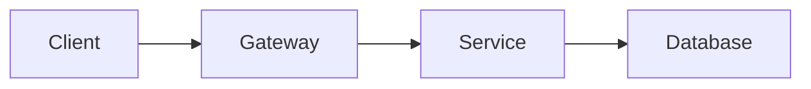

{{meta}}

{{toc}}

## 1. Summary

{Two or three sentences: what is being proposed, why now, and what decision the reviewers must make. A reader who stops here should still understand the ask.}

:::info
**Decision requested by {date}.** Approve option {A/B/C} or return written objections to {Owner} on {Jira key}.
:::

| Attribute | Value |
|---|---|
| Decision owner | {Name, role} |
| Reviewers | {Names, roles} |
| Decision deadline | {YYYY-MM-DD} |
| Reversibility | {Easy / costly / irreversible} |
| Blast radius | {Systems, tenants or customers affected} |

## 2. Motivation

{Describe the problem, the evidence, and the cost of doing nothing. Quantify where possible: incident count, latency, conversion loss, manual hours.}

| Signal | Current state | Target state | Source |
|---|---|---|---|
| {Metric} | {Baseline} | {Target} | {Dashboard or study} |
| {Metric} | {Baseline} | {Target} | {Dashboard or study} |
| {Metric} | {Baseline} | {Target} | {Dashboard or study} |

:::note
Separate symptoms from causes. If the root cause is not yet proven, state the hypothesis and the cheapest experiment that would confirm it.
:::

## 3. Proposal

{Describe the chosen approach in implementation order. Name the components, data flows, interfaces and ownership boundaries. Include what is explicitly not changing.}

### 3.1 Design

| Component | Responsibility | Owner | Change type |
|---|---|---|---|
| {Component} | {Responsibility} | {Team} | New / modified / retired |
| {Component} | {Responsibility} | {Team} | New / modified / retired |

### 3.2 Data and interfaces

| Interface | Direction | Contract | Failure mode |
|---|---|---|---|
| {Interface} | {Inbound/outbound} | {API, event or file} | {Timeout, retry, dead letter} |

### 3.3 Implementation plan

| Phase | Scope | Exit criteria | Owner |
|---|---|---|---|
| 1 | {Foundation or spike} | {Measurable exit criterion} | {Team} |
| 2 | {Pilot} | {Measurable exit criterion} | {Team} |
| 3 | {Full rollout} | {Measurable exit criterion} | {Team} |

## 4. Alternatives

| Option | Description | Pros | Cons | Cost | Decision |
|---|---|---|---|---|---|
| A | {Chosen approach} | {Benefits} | {Trade-offs} | {Estimate} | Selected |
| B | {Alternative} | {Benefits} | {Trade-offs} | {Estimate} | Rejected: {reason} |
| C | {Do nothing} | {Benefits} | {Trade-offs} | {Estimate} | Rejected: {reason} |

## 5. Risks

| ID | Risk | Likelihood | Impact | Mitigation | Owner | Status |
|---|---|---|---|---|---|---|
| RSK-001 | {Risk introduced by the proposal} | Medium | High | {Mitigation or contingency} | {Owner} | {{status:yellow\|Open}} |
| RSK-002 | {Operational or security risk} | Low | High | {Mitigation or contingency} | {Owner} | {{status:grey\|Monitoring}} |
| RSK-003 | {Delivery risk} | Medium | Medium | {Mitigation or contingency} | {Owner} | {{status:grey\|Monitoring}} |

## 6. Rollout

| Step | Action | Verification | Rollback trigger | Owner |
|---|---|---|---|---|
| 1 | {Deploy behind a flag} | {Metric or check} | {Threshold} | {Team} |
| 2 | {Enable for internal users} | {Metric or check} | {Threshold} | {Team} |
| 3 | {Increase to 10% of traffic} | {Metric or check} | {Threshold} | {Team} |
| 4 | {Full rollout} | {Metric or check} | {Threshold} | {Team} |

:::warning
A rollout without a measurable rollback trigger is not a rollout plan. Define the threshold before the first deploy.
:::

## 7. Open Questions

| ID | Question | Owner | Needed by | Status |
|---|---|---|---|---|
| OQ-001 | {Question blocking approval} | {Owner} | {YYYY-MM-DD} | {{status:red\|Open}} |
| OQ-002 | {Question blocking rollout} | {Owner} | {YYYY-MM-DD} | {{status:yellow\|In Review}} |
| OQ-003 | {Resolved question kept for context} | {Owner} | {YYYY-MM-DD} | {{status:green\|Resolved}} |

## 8. Change Log

| Version | Date | Author | Change | Jira |
|---|---|---|---|---|
| 0.1 | {YYYY-MM-DD} | {Author} | Initial draft | {{jira:{EPIC-KEY}}} |
