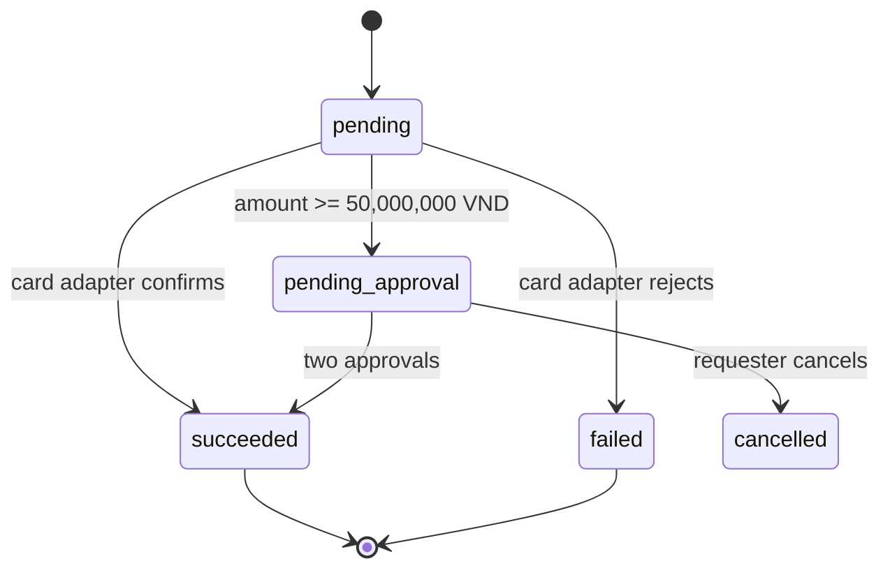
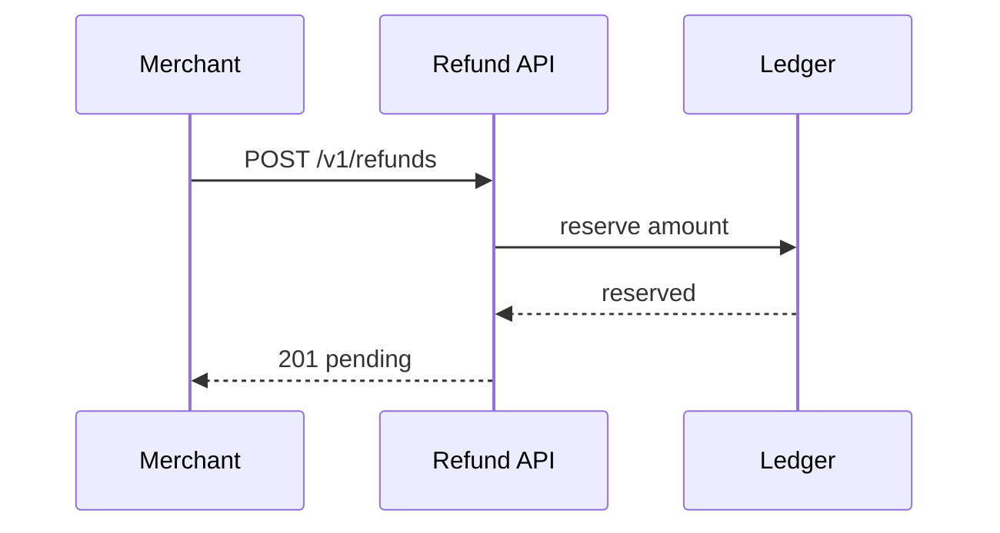

# Confluence Documents Guide: Diagrams and Visuals

## 1. Definition

A diagram is a compressed argument about structure or behaviour: who calls whom, which state follows which, how entities relate. It earns its space when a table or paragraph cannot express the relationship as quickly. The source must live with the page, the caption must state the conclusion, and the alt text must describe that conclusion for readers who cannot see it.

## 2. Core Principles

- **One message per diagram:** topology, sequence, state or relationship — not all four at once.
- **Diagram for relationships, table for rules:** if the content is a list of conditions with values, use a table.
- **Label every edge:** an unlabelled arrow is a guess; name the call, event or transition.
- **Consistent notation:** C4 for architecture, UML sequence for interactions, state machine for lifecycle, crow's foot for ER.
- **Source is part of the document:** keep Mermaid/PlantUML text or the draw.io source attachment; a PNG alone cannot be reviewed.
- **Caption states the takeaway:** `Figure 1 — Refund moves from pending to succeeded only after the card adapter confirms.`
- **Alt text is mandatory:** describe what the diagram shows and the conclusion, not "diagram.png".
- **Version the diagram with the page:** a changed flow needs a new version and a change-log row.

## 3. Spec Tokens

| Role | Token | Value | Notes |
|---|---|---|---|
| Diagram types | `--diagram-types` | `C4, sequence, state, ER, flowchart` | Match the question, not fashion |
| Node budget | `--diagram-max-nodes` | `15` | Above this, split into views |
| Edge budget | `--diagram-max-edges` | `20` | Hairballs hide the failure path |
| Alt text | `--diagram-alt` | `required` | 8–20 words stating the conclusion |
| Caption | `--diagram-caption` | `Figure N — {takeaway}` | Numbered in reading order |
| Colour count | `--diagram-colours` | `≤ 4` | Redundant with labels |
| Source format | `--diagram-source` | `Mermaid or PlantUML text` | PNG is an export, not the source |
| Export density | `--diagram-export` | `2x PNG` | For readers without the macro |
| Direction | `--diagram-direction` | `left-to-right or top-down` | Consistent within a page |

## 4. Composition

- **With storage-format (guide 04):** the macro name depends on the installed app; confirm `mermaid` or `plantuml` in the tenant.
- **With visual-hierarchy (guide 03):** a diagram is a visual container like a table; introduce it with a lede and caption it.
- **With readability-accessibility (guide 11):** alt text and long description are not optional.
- **With api-contracts (guide 09):** sequence diagrams complement the endpoint table; the table remains normative.

## 5. Signature Patterns

- **Context diagram:** the system in the middle, external actors and systems around it, labelled protocols.
- **Sequence diagram:** happy path first, then one diagram for the failure path; avoid mixing ten scenarios.
- **State machine:** states as nouns, transitions as verbs, guards on the edge label.
- **ER diagram:** entities and cardinality only; field detail belongs in the schema table.
- **Diagram + explanation table:** image on top, "element / responsibility / owner" table below.
- **Before/after pair:** two small diagrams are clearer than one diagram with a legend of dashed lines.

## 6. Real-World Use Cases

- **Refund lifecycle** — a state machine prevents arguments about when `succeeded` is allowed.
- **Incident data flow** — a sequence diagram shows where the timeout occurred and which retry fired.
- **Service topology** — a C4 context diagram names the owners of each boundary.
- **Data migration** — an ER diagram plus a field mapping table proves parity.

## 7. Combination Notes

### With other confluence-document skills

- **Tables and matrices:** use a table for rules and a diagram for flow; do not encode business rules as arrows.
- **Storage format:** keep the diagram macro source in the page so it survives export and review.
- **Readability:** alt text is part of the document, not metadata added at publish time.
- **Update and versioning:** a diagram change is a content change; mention it in the version message.

### With design-system companions

- **skill-color-theory:** limit the palette and never rely on colour alone to distinguish paths.
- **skill-icons-illustration:** use icons as labels, not decoration; a legend is cheaper than guessing.

## 8. Anti-Patterns

- **Screenshot-only diagram with no source or alt text** — cannot be edited, reviewed or described
- **Unlabelled arrows that leave the flow ambiguous** — the reader invents the contract
- **Hairball diagram with 40 nodes and no grouping** — proves complexity, not understanding
- **Decorative stock images in a specification** — consumes attention without evidence
- **Diagram that contradicts the written contract** — two sources of truth, one of them wrong

### Accessibility Notes

Alt text should state the conclusion: "Refund stays pending until the card adapter confirms, then moves to succeeded." For complex diagrams, add a long description in the paragraph below or an expand with the step sequence. Never use colour alone to distinguish success from failure; label edges and states. If the diagram is only available as an image, provide the same information as a table.

## 9. Code Examples

### Example 1 — Mermaid state and sequence diagrams

````markdown



````

### Example 2 — Image with alt text and caption

```markdown


**Figure 1 — Refund lifecycle.** A refund cannot reach `succeeded` without a ledger reservation and a card-adapter confirmation.
```

```bash
# Upload the rendered export as an attachment, keep the source in the page.
python3 scripts/confluence.py attach --page-id 12345 --file refund-state.png
```

## 10. Implementation Checklist

- [ ] The diagram answers one question and has one primary message.
- [ ] Nodes stay at or below 15 and edges at or below 20; otherwise split the view.
- [ ] Every edge is labelled with the call, event, condition or transition.
- [ ] The notation matches the question (C4, sequence, state, ER).
- [ ] Source text or the editable file is stored with the page, not only the PNG.
- [ ] Alt text states the conclusion; a long description exists for complex diagrams.
- [ ] A numbered caption states the takeaway.
- [ ] The diagram and the written contract agree on states, names and owners.
